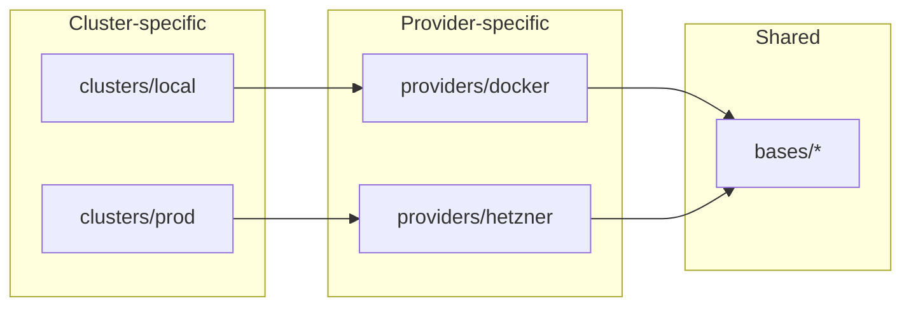
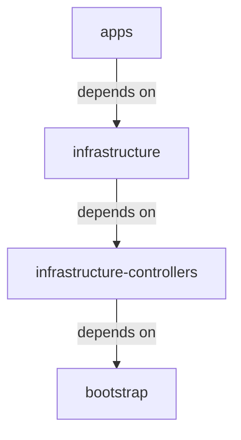

# Architecture

## Environments

### Local

Local development cluster running on Docker via KSail. Uses Talos with the
Docker provider. A small, thin manual test-bed (see
[local development](local-development.md)) — bring up a component, try it, then
promote it to prod.

- 1 control-plane node + 1 worker node (Docker containers)
- Config: [`ksail.yaml`](../ksail.yaml)

### Production

Cloud cluster running on Hetzner Cloud via KSail's native Hetzner provider.
Changes are verified through the production-deploying merge queue before landing
on the default branch.

- Control planes, static workers, and autoscaling compute workers; sizing lives
  in the configuration.
- Config: [`ksail.prod.yaml`](../ksail.prod.yaml)

## Platform components

A high-level inventory of what Flux reconciles onto the cluster. The manifests
live under [`k8s/bases/infrastructure/`](../k8s/bases/infrastructure) and
[`k8s/bases/apps/`](../k8s/bases/apps), with provider-specific pieces (Hetzner
CCM/CSI, Longhorn, external-dns, …) under [`k8s/providers/`](../k8s/providers).
The sections below describe the main building blocks, not every deployed
resource. The provider overlays select the exact set; the local Docker overlay
ships only core controllers by default and makes additional components opt-in.

### Infrastructure

- **GitOps & config** — Flux Operator, Reloader
- **Networking** — Cilium (CNI + Gateway API), CoreDNS, external-dns
  (Cloudflare), Hetzner CCM (prod)
- **Certificates** — cert-manager, trust-manager, Cloudflare Origin CA issuer
- **Secrets** — OpenBao + External Secrets Operator (runtime), SOPS + Age
  (at-rest seeds)
- **Identity / SSO** — Dex (OIDC) with oauth2-proxy / auth-proxy; see
  [`docs/oidc-kubectl.md`](oidc-kubectl.md)
- **Policy & runtime security** — Kyverno, Kubescape, Tetragon; see
  [`docs/runtime-security.md`](runtime-security.md)
- **Storage** — Longhorn (replicated block/RWX, stored on each worker's own
  disk), Hetzner CSI (separately billed block volumes, prod only),
  CloudNativePG (PostgreSQL operator); see
  [`docs/rwx-storage.md`](rwx-storage.md)
- **Autoscaling** — Cluster Autoscaler (nodes), SIG Descheduler (pod
  rebalancing + node consolidation), Vertical Pod Autoscaler, KEDA request-rate
  autoscaling (homepage/umami); see
  [`docs/node-autoscaling.md`](node-autoscaling.md)
- **Progressive delivery** — Flagger (Gateway API canary deployments with
  SLO-gated automated rollback, metrics from Coroot); see
  [`docs/progressive-delivery.md`](progressive-delivery.md)
- **Observability** — Coroot (self-hosted, eBPF: metrics, logs, traces,
  profiling, service map, SLO alerting, cost allocation); see
  [`docs/dr/alerting.md`](dr/alerting.md)
- **Backup / DR** — Velero with CloudNativePG backups; see [`docs/dr/`](dr)
- **Virtualization** — KubeVirt + CDI _(opt-in locally; disabled on the
  Hetzner/prod overlay)_

### Apps

Application manifests live in [`k8s/bases/apps/`](../k8s/bases/apps).

- Homepage (dashboard), Headlamp (Kubernetes UI), Umami (analytics), Actual
  Budget (budgeting), `whoami` (debug)
- The [apps assembly](../k8s/bases/apps/kustomization.yaml) declares which
  optional applications are enabled.
- **Tenants** — apps deployed from their own repositories (`ascoachingogvaner`,
  `wedding-app`); see [`docs/TENANTS.md`](TENANTS.md)

## Structure

The cluster uses Flux GitOps to reconcile the state of the cluster with the
single source of truth stored in this repository and published as an OCI image.
KSail is used for local development, CI/CD testing, and production deployments.
For prod, nodes are provisioned on Hetzner Cloud by KSail's native Hetzner
provider, which also installs the Hetzner CCM and CSI drivers.

All environments use the Talos Kubernetes distribution. Local development uses
Talos with the Docker provider; prod uses Talos with the Hetzner provider. CI
validates manifests without creating a local cluster; the merge queue also
verifies changes against production.

The cluster configuration is stored in the `k8s/*` directories where the
structure is as follows:

- [`clusters/`](../k8s/clusters): Contains the cluster-specific configuration
  for each environment.
  - [`base`](../k8s/clusters/base): Contains the shared Flux Kustomizations with
    sentinel paths (`__CLUSTER__`, `__PROVIDER__`).
  - [`local`](../k8s/clusters/local): Contains the local cluster-specific
    configuration.
  - [`prod`](../k8s/clusters/prod): Contains the production cluster-specific
    configuration.
- [`providers/`](../k8s/providers): Contains the provider-specific
  configuration.
  - [`docker`](../k8s/providers/docker): Contains the Talos+Docker specific
    configuration for local development.
  - [`hetzner`](../k8s/providers/hetzner): Contains the Talos+Hetzner specific
    configuration for production.
- [`bases/`](../k8s/bases): Contains the different bases that are used for the
  different clusters and providers.
  - [`infrastructure`](../k8s/bases/infrastructure): Contains the different
    infrastructure components that are used for the different clusters and
    providers.
  - [`apps`](../k8s/bases/apps): Contains the different apps that are used for
    the different clusters and providers.
  - [`bootstrap`](../k8s/bases/bootstrap): The foundational **bootstrap layer**.
    Holds the shared substitution variables (`variables-base` ConfigMap +
    SOPS-encrypted Secret) and cluster-scoped PriorityClasses (e.g.
    `platform-critical`), reconciled by the `bootstrap` Flux Kustomization
    before everything that `dependsOn` it.

### How the layers fit together

Two things stack up. First, each environment points at a provider, which patches
the shared resources — so a change can be made for one cluster, for one
provider, or for everything at once:

Second, Flux applies those layers in order, each waiting for the one before it
to come up:

The controllers, infrastructure, and apps layers have matching folders under
`providers/<provider-name>/` and `bases/`. The `infrastructure` layer, for
example, is backed by `k8s/providers/<provider-name>/infrastructure/` and
`k8s/bases/infrastructure/`.

Bootstrap is cluster-specific: its Kustomization maps to
`k8s/clusters/<cluster-name>/bootstrap/`, not a provider folder.

The layer definitions themselves are written once in `k8s/clusters/base/` with
placeholders where the cluster and provider names go; each cluster's overlay
fills those in. Only the per-cluster `bootstrap/` directory holds manifests
unique to one cluster.

- [`docs/TEMPLATING.md`](TEMPLATING.md) — the exact files a fork must edit,
  including how those placeholders get filled in.
- [`docs/TENANTS.md`](TENANTS.md) — adding a **tenant**: an app that runs on the
  platform from its own repository.
