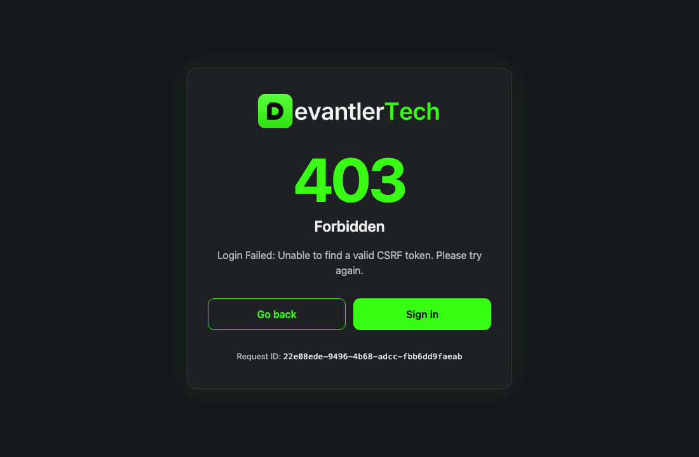
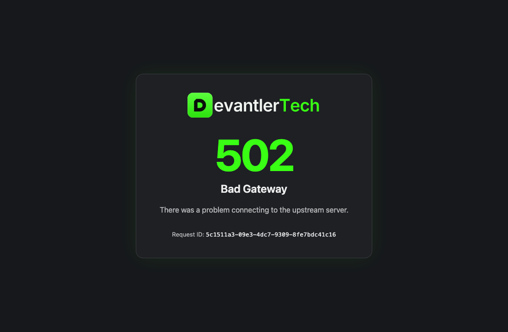
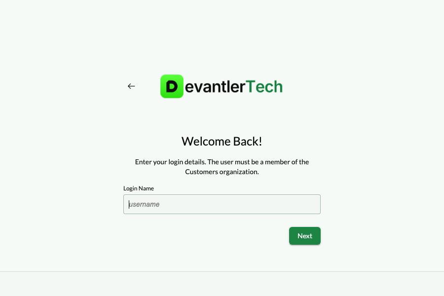
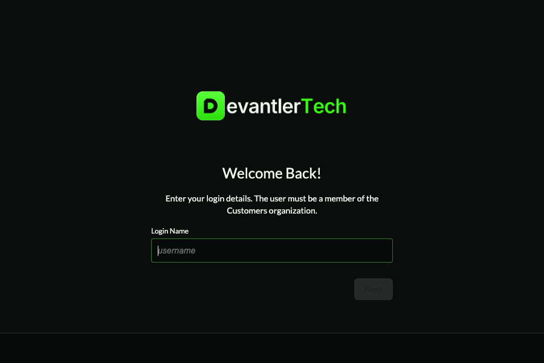

# Devantler Tech brand

The logo and colours the platform's self-hosted pages use. The maintainer approved this logo on
2026-11-15.

## Logo

| File | Use it for |
| --- | --- |
| `devantler-tech-icon.svg` | Anything square: favicons, app and touch icons, avatars and square logo slots. A rounded square shaded around the brand green `#39FF14` (`#5BFF3C` to `#2CE00E`) with a fine white edge highlight, and a custom near-black `#0A0D0B` "D" whose top-left corner is cut at 45°. |
| `devantler-tech-logo-dark.svg` | Headers and sign-in pages on dark backgrounds. The icon's "D" starts the name, so it reads "[D]evantlerTech": "evantler" in `#F1F5F1`, "Tech" in `#39FF14`. |
| `devantler-tech-logo-light.svg` | The same wordmark on light backgrounds: "evantler" in `#0A0D0B`, "Tech" in `#15803D`. |

The vector source is these three SVGs in devantler-tech/business-site `src/assets/brand/`. The
letters are Inter (SIL Open Font License) converted to outlines, so no font is needed to draw them.
Export PNGs from the SVGs at the size a page needs, rather than scaling another PNG.

KSail publishes only YAML and JSON files, so a page in the cluster cannot load image files from a
repository. Each page embeds the files it needs in its own ConfigMap:

- Dex: [`dex-theme`](../k8s/bases/infrastructure/controllers/dex/config-map.yaml) holds
  `favicon.png` (the icon at 256 px) and `logo.svg` (the dark-background wordmark).
- The customer Dex (login.devantler.tech):
  [`customer-dex-theme`](../k8s/providers/hetzner/apps/customer-identity/config-map-dex-theme.yaml)
  is a copy of `dex-theme` with only its name and namespace changed;
  `scripts/tests/test-dex-theme-mount.sh` fails when the two differ.
- Homepage: [`homepage-brand`](../k8s/bases/apps/homepage/config-map-brand.yaml) holds the icon at
  180, 192 and 512 px and as `icon.svg`.
- Policy Reporter: [`policy-reporter-brand`](../k8s/bases/infrastructure/policy-reporter/config-map.yaml)
  holds `logo.png` (the icon at 180 px) and `favicon.ico` (the icon at 32, 64 and 180 px). They
  replace the UI's own files, which a running pod does not refresh, so a change also sets
  `platform.devantler.tech/brand-sha256` in its HelmRelease to the new `logo.png`'s sha256.
- The single sign-on proxy's error page (oauth2-proxy):
  [`oauth2-proxy-templates`](../k8s/bases/infrastructure/controllers/oauth2-proxy/config-map.yaml)
  holds `error.html`, which inlines the Dex `logo.svg` and Homepage's `icon.svg`, because the
  proxy serves no files of its own. `scripts/oauth2-proxy-error-page` fails when either inlined
  copy differs from its source, and when the template would not parse or render.
  
  
- ZITADEL (accounts.devantler.tech and its emails):
  [`zitadel-branding`](../k8s/providers/hetzner/apps/customer-identity/config-map-branding.yaml)
  holds both wordmarks and the icon as PNG, because email clients do not show SVG. The setup
  CronJob owns ZITADEL's whole label policy (colours, logos, icon, no font or watermark), so an
  edit in its console is undone on the next run.
  
  

devantler.tech uses the same icon at 256 px as its `favicon.png` and shows the wordmark that matches
its theme in the header. When the logo changes, update every copy above in the same change.

## Colours

| Name | Value |
| --- | --- |
| Accent (neon green) | `#39ff14` |
| Accent, lighter | `#7aff6e` |
| Accent, dark tint | `#0a2e14` |
| Accent on light backgrounds | `#15803d` |
| Logo ink | `#0a0d0b` |
| Page background on the platform's dark pages | `hsl(224, 10%, 10%)` |

The shared brand kit with icon sets and colour tokens is tracked in
[#5054](https://github.com/devantler-tech/platform/issues/5054).
