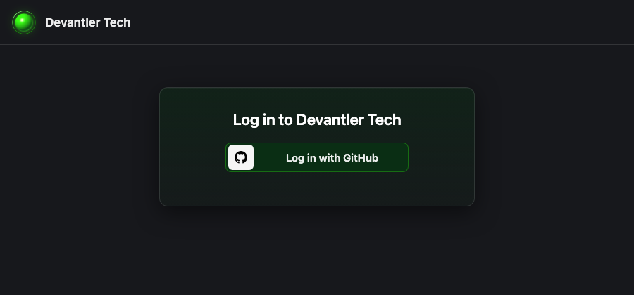
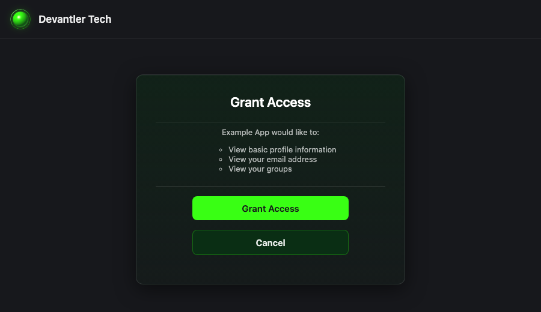
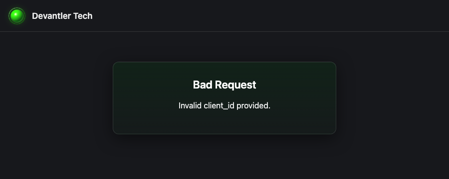

# Dex

A federated OpenID Connect provider for Kubernetes.

- [Documentation](https://dexidp.io/docs/)
- [Helm Chart](https://github.com/dexidp/helm-charts/tree/master/charts/dex)

## Sign-in pages

Dex's pages carry the Devantler Tech look: the green orb logo, the devantler.tech
dark backdrop and neon-green buttons, links and focus rings.

- [`config-map.yaml`](config-map.yaml) holds the theme: its stylesheet and the logo.
- `config.frontend` in [`helm-release.yaml`](helm-release.yaml) names the theme and
  the page title, and the release mounts the ConfigMap beside Dex's built-in themes.
- [`test-dex-theme-mount.sh`](../../../../../scripts/tests/test-dex-theme-mount.sh)
  fails CI when the theme Dex is told to use is not the directory that is mounted.

Dex skips two of these pages in this setup. With GitHub as the only connector it
sends people straight to GitHub, and `skipApprovalScreen` skips the approval page.
The page people do see is the error page, for example when their account is not in
the `maintainers` team. Setting `config.oauth2.alwaysShowLoginScreen: true` would
show the sign-in page first, at the cost of one more click on every sign-in.

