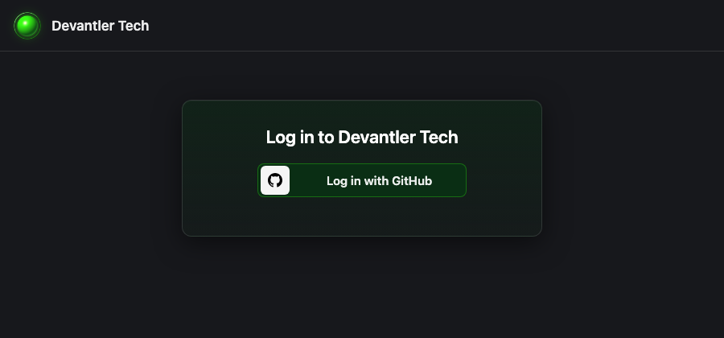
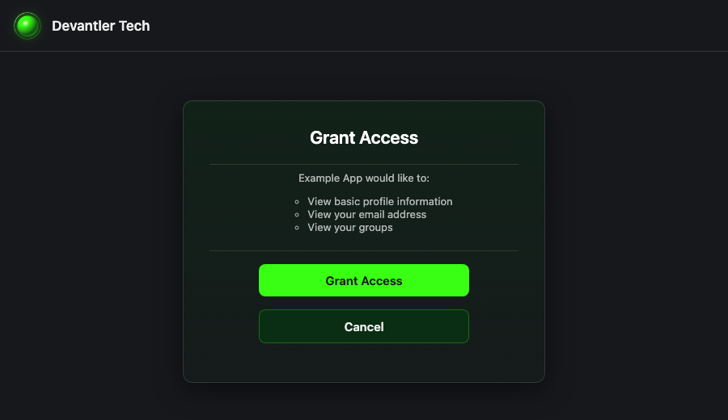
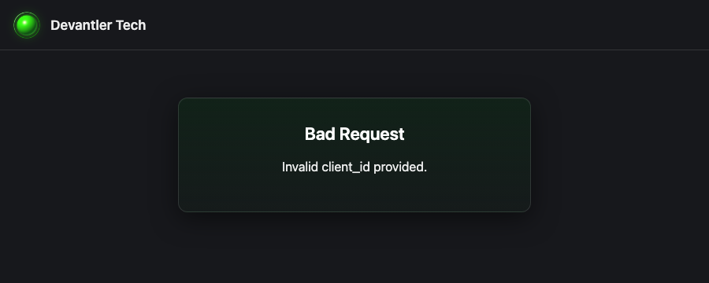

# Dex

A federated OpenID Connect provider for Kubernetes.

- [Documentation](https://dexidp.io/docs/)
- [Helm Chart](https://github.com/dexidp/helm-charts/tree/master/charts/dex)

## Source-built distribution

[`publish-dex-security-image.yaml`](../../../../../.github/workflows/publish-dex-security-image.yaml)
builds a reviewed Dex release with the narrow dependency correction in
[`dex-v2.46.1-network.patch`](dex-v2.46.1-network.patch). It verifies the exact
upstream commit and patched tree, runs the upstream command, server, memory-store
and OIDC connector tests, then compiles a static executable with SQLite support.
The runtime contains that musl-linked executable, upstream web files, CA
certificates, license notices and a passive source archive covering the patched
upstream and vendored dependencies. It accepts native Dex configuration and launches directly;
gomplate templates are outside this distribution's contract.

The admission command runs the pinned scanner on the actual executable itself.
Missing module coverage or a new reachable finding refuses publication. One
historical advisory has an open-ended Go version mapping but an upstream custom
range fixed before this release. Its disposition requires unchanged primary
metadata, the fixing commit's ancestry, the exact patched executable's build
information, and real HTTPS **and** gRPC handshakes. Configured TLS 1.3 must work
before and after an observed renewal on both endpoints; TLS 1.2, a wrong CA and a wrong hostname must
fail. A real TLS-1.2-configured negative control must fail admission. This is a
specific fix-or-refute decision, not a scanner suppression or a claim that all
required modules are free of advisories.

Renewal writes a new certificate with a distinct issuer and serial, waits until
both endpoints serve that leaf, and repeats the controls with its new trust
pool. A deliberately non-shipping reloader mutation must fail that observation.
The immutable archive name comes from its producing job's output, so a partial
publisher retry retains the successful verification attempt's artifact.

CI also extracts and rechecks the packaged executable and web files. Publication
loads the same archive produced by verification, checks both its hash and image
identity, and pushes those bytes without rebuilding. The main-only workflow
signs the resulting digest and attaches verified build and CycloneDX statements.
Image tags identify the source revision; consumers must use the verified digest.

The infrastructure broker runs this distribution: [`helm-release.yaml`](helm-release.yaml)
pins one published digest, and both workload admission and node image pulls
accept that repository only with this workflow's main-branch signature. Moving
to a newer build is a reviewed change of that digest pin.
The infrastructure broker and any customer broker retain independent
configuration, clients, credentials and storage.

## Sign-in pages

Dex's pages carry the Devantler Tech look: the green orb logo, the devantler.tech
dark backdrop and neon-green buttons, links and focus rings.

- [`config-map.yaml`](config-map.yaml) holds the theme: its stylesheet and the logo.
- `config.frontend` in [`helm-release.yaml`](helm-release.yaml) names the theme and
  the page title, and the release mounts the ConfigMap beside Dex's built-in themes.
- [`test-dex-theme-mount.sh`](../../../../../scripts/tests/test-dex-theme-mount.sh)
  fails CI when the theme Dex is told to use is not the directory that is mounted.

Dex skips two of these pages in this setup. With GitHub as the only connector it
sends people straight to GitHub, and `skipApprovalScreen` skips the approval page.
The page people do see is the error page, for example when their account is not in
the `maintainers` team. Setting `config.oauth2.alwaysShowLoginScreen: true` would
show the sign-in page first, at the cost of one more click on every sign-in.

